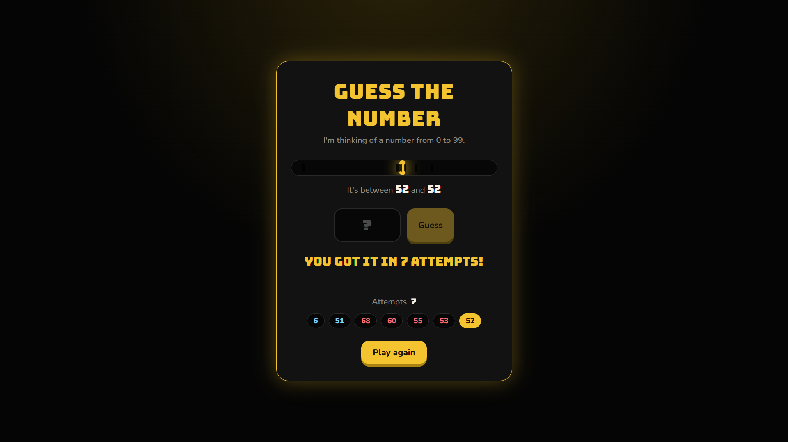

# Number Guess Game

A number guessing game with a **Java backend** and a **black-and-gold web interface**. The Java server holds the secret number and the game logic. The browser sends guesses to it over a small REST API. A correct guess sets off a confetti victory animation.



## Features

- Guess a number from 0 to 99 and get "too high" or "too low" feedback
- Live range bar that narrows as you rule numbers out, with a tick for every guess
- Attempt counter and guess history
- Give up and Play again buttons
- Confetti, glow and bounce animation on a win (drawn on a `<canvas>`, no libraries)
- Keyboard friendly, responsive, and respects the "reduce motion" system setting

## Tech stack

| Layer | Tools |
|-------|-------|
| Backend | Java, `com.sun.net.httpserver.HttpServer` (built into the JDK, no frameworks) |
| Frontend | HTML, CSS, vanilla JavaScript (`fetch` API) |

## How it works

```
Browser (web/)  --POST /api/guess?n=42-->  GuessServer.java
                <--{"result":"low","attempts":3}--
```

The secret number never leaves the server, so it can't be read from the browser's DevTools.

| Endpoint | Method | Purpose |
|----------|--------|---------|
| `/api/new` | POST | Start a new game with a fresh secret number |
| `/api/guess?n=42` | POST | Submit a guess. Returns `low`, `high` or `win` plus the attempt count |
| `/api/giveup` | POST | Reveal the secret number and reset the game |

## Project structure

```
.
├── src/com/lesson/MiniProject/
│   ├── jav.java           # Original console version of the game
│   └── GuessServer.java   # HTTP server + game logic
├── web/
│   ├── index.html
│   ├── style.css
│   └── script.js
└── README.md
```

## Run it locally

**Requirements:** JDK 11 or newer.

1. Clone the repo:
   ```bash
   git clone https://github.com/<your-username>/number-guess-game.git
   ```
2. Open it in IntelliJ IDEA.
3. Run `GuessServer` from the **project root**, so the `web/` folder is found.
4. Open **http://localhost:8080** in your browser.

To play the console version instead, run `jav.java`.

## What I learned

- Building a REST-style API with only the JDK
- Serving static files safely (blocking `../` path tricks)
- Keeping shared state thread-safe with `synchronized`
- Connecting a frontend to a backend with `fetch`
- Animating on a canvas with `requestAnimationFrame`

## Roadmap

- [ ] Per-player sessions, so each player gets their own secret number
- [ ] Leaderboard with best scores
- [ ] Difficulty levels (bigger ranges, limited guesses)
- [ ] Sound effects

## License

MIT
